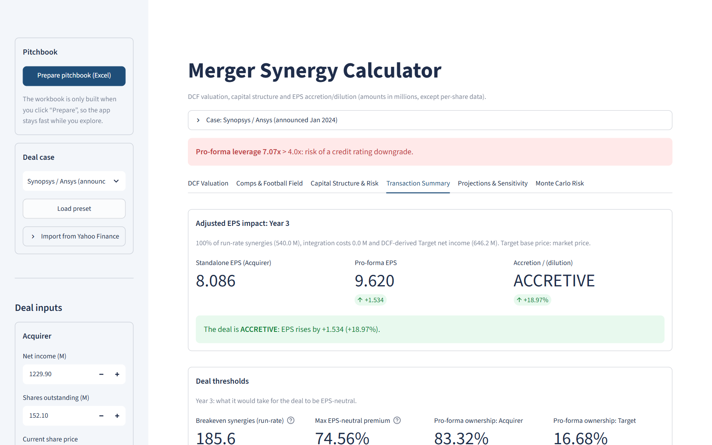
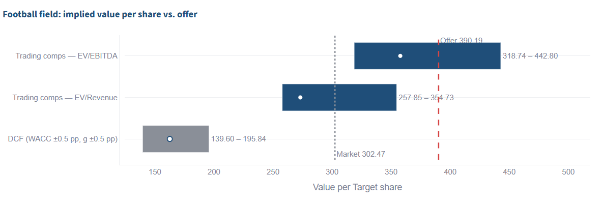
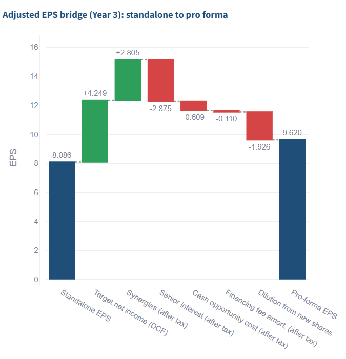
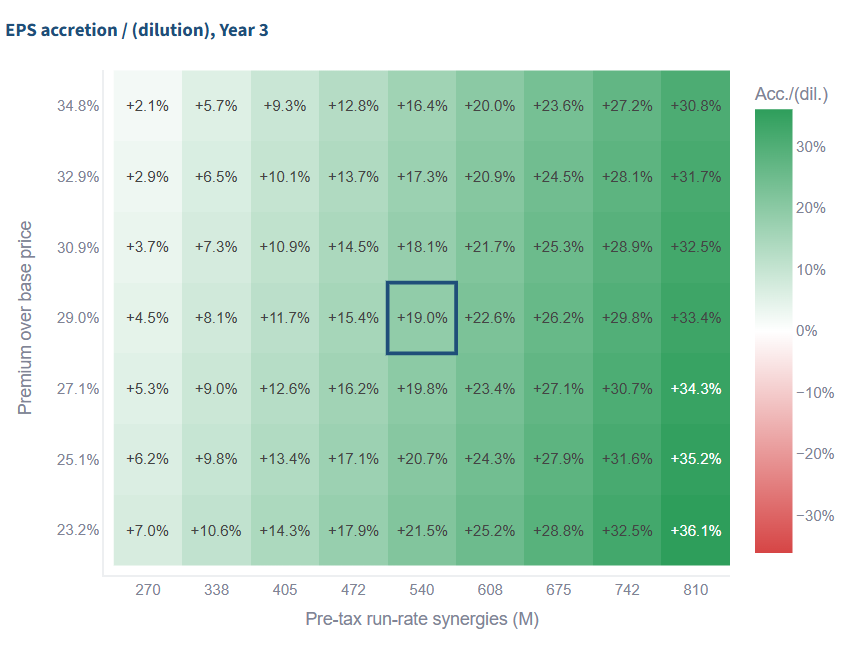
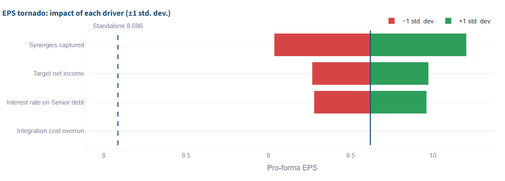

# Merger Synergy Calculator

**An M&A accretion/dilution model with a DCF, purchase price allocation, debt schedule, trading comps, a football field and a multi-variable Monte Carlo, delivered as an interactive Streamlit app with a one-click Excel pitchbook.**

[](__LIVE_URL__)
[](https://github.com/__REPO__/actions/workflows/tests.yml)




---

## Why this project

Most accretion/dilution calculators stop at "add the two net incomes and divide by the new share count". This one models the items that actually decide whether a deal works, and it is checked against a real transaction:

- **Purchase price allocation**: excess price → identifiable intangibles (amortised) + deferred tax liability + goodwill.
- **Funding and fees**: balance sheet cash at an opportunity cost, an amortising Senior tranche, bullet Mezzanine, advisory and financing fees. The fee/debt circularity is solved in closed form.
- **GAAP vs. adjusted EPS**: adjusted EPS excludes PPA amortisation and integration costs, the way acquirers present deals.
- **Breakeven analysis**: the run-rate synergies needed for EPS neutrality, the maximum premium that keeps the deal non-dilutive, and pro-forma ownership vs. contribution.
- **Relative valuation**: trading comps and precedent transactions, with a football field against the offer price.
- **Risk**: a 5,000-draw Monte Carlo on synergies, Target earnings (correlated), a floating-rate shock and integration overruns, plus an EPS tornado chart.

## Case study: Synopsys / Ansys (announced January 2024)

The app ships with the real deal as a preset: **$197.00 cash + 0.3450 Synopsys shares per Ansys share**, ≈ $35 bn enterprise value, $400 M of run-rate cost synergies and $400 M of revenue synergies. Financials come from Ansys' FY2023 SEC filing and from Yahoo Finance for Synopsys; every analyst assumption is flagged in the app.

| Check against public information | Disclosed | Model |
|---|---|---|
| Implied value per Ansys share | $390.19 | **$390.19** |
| Ansys holders' pro-forma ownership | ≈ 16.5% | **16.7%** (cash mix rounded to 50%) |
| Non-GAAP EPS | "accretive within the second full year", "substantially accretive thereafter" | **−2.1%** Year 2 (≈ neutral), **+19.0%** Year 3 (adjusted) |

What the model shows:

- **GAAP EPS tells a different story**: −27.1% in Year 3, driven by ≈ $861 M a year of PPA amortisation on ≈ $8.6 bn of intangibles (with ≈ $21.9 bn of goodwill). This is why acquirers guide on adjusted EPS.
- **Synergy cushion**: on an adjusted basis the deal breaks even at **≈ $186 M** of run-rate synergies, against ≈ $540 M modelled.
- **Valuation**: the offer is **44.8x LTM GAAP EBITDA**. That is inside the interquartile range of engineering-software peers *as of the undisturbed date*, but above what a standalone GAAP DCF supports.

  
- **Leverage at close is 7.1x on GAAP EBITDA**, which explains why the company quoted leverage on adjusted EBITDA (target < 2x within two years).
- **Risk**: the deal is accretive in **96.7%** of simulations in Year 3; synergy capture is the largest EPS driver.

<p float="left">
  
  
</p>



## Features

| Tab | What it does |
|---|---|
| **DCF Valuation** | 5-year unlevered DCF of the Target (Gordon growth terminal value), EV → equity bridge, WACC × g grid. The DCF also produces the Target's net income used in the pro-forma EPS. |
| **Comps & Football Field** | Editable trading comps and precedents; fetch current peer multiples by ticker. The football field compares comps, precedents, the DCF range and the 52-week range with the market and offer prices. |
| **Capital Structure & Risk** | Cash / Senior / Mezzanine split, sources & uses with fees, a 3-year debt schedule, credit metrics and net debt / EBITDA alerts. |
| **Transaction Summary** | GAAP or adjusted EPS impact, breakeven synergies, max EPS-neutral premium, EPS bridge waterfall, PPA, contribution vs. ownership. |
| **Projections & Sensitivity** | 3-year accretion/dilution with synergy phasing, and a premium × synergies grid whose centre matches the summary. |
| **Monte Carlo Risk** | Multi-driver simulation with a correlation input, probability of accretion, downside EPS, tornado chart. |

You can also:
- **Load a deal case** (illustrative or Synopsys / Ansys), or **import any two listed companies** by ticker from Yahoo Finance. The import sets fundamentals, DCF inputs and a CAPM WACC.
- **Export a pitchbook**: an Excel workbook with 7 formatted sheets (assumptions, DCF, valuation, capital structure, summary, sensitivity, Monte Carlo), native charts and every simulation draw.

## Methodology (short version)

- **Pro-forma NI** = Acquirer NI + Target NI (from the DCF) + (synergies − integration − financing cost − fee amortisation − PPA amortisation) × (1 − t). Adjusted EPS drops PPA amortisation and integration costs.
- **Run-rate synergies** = cost synergies + revenue synergies × EBITDA margin.
- **PPA**: excess = price − book equity; intangibles = % of excess (amortised over their useful life); DTL = intangibles × t; goodwill = excess − intangibles + DTL.
- **Funding**: total cash uses U = (cash consideration + advisory fees) / (1 − financing fee % × debt share).
- **Breakeven synergies** are solved in closed form (NI is linear in synergies); the **max premium** is found by bisection.
- **Comps** are applied to LTM metrics: implied price = (multiple × metric − net debt) / shares, using interquartile ranges. The preset peer set is computed *as of the undisturbed date* to avoid look-ahead bias (`scripts/build_comps_snapshot.py`).

Each tab has a methodology expander with the full formulas.

## Architecture

```
app.py               Streamlit entry point: orchestrates tabs, isolates failures per tab
engine/              Pure financial model (no Streamlit): unit-tested, notebook-friendly
  dcf.py             DCF and WACC × g sensitivity
  deal.py            synergies, PPA, funding & debt schedule, pro-forma EPS, breakeven, ownership
  valuation.py       comps / precedents implied values, football field
  analytics.py       sensitivity grid, multi-variable Monte Carlo, EPS tornado
marketdata/          Yahoo Finance fetch + pure mapping to inputs; preset cases with sources
reports/excel.py     Excel pitchbook (xlsxwriter, in memory)
ui/                  Sidebar, one module per tab, shared components
tests/               39 tests: engine maths, data mapping, end-to-end app runs (Streamlit AppTest)
scripts/             Comps snapshot builder, README screenshot generator
```

Design choices worth noting:
- **Single source of truth**: the DCF feeds both the price and the Target's earnings; the summary, sensitivity grid and Monte Carlo share one base case. Tests check that they agree.
- **Heavy computations are cached** (`st.cache_data`), and the Excel file is built only on demand.
- **Every widget reads from session state**, so a whole deal case can be loaded in one click.

## Run locally

```bash
git clone https://github.com/__REPO__.git
cd merger-synergy-calculator
pip install -r requirements.txt
streamlit run app.py
```

Run the tests:

```bash
pip install -r requirements-dev.txt
pytest
```

## Data sources and limitations

- Synopsys / Ansys: [deal announcement](https://ansys.synopsys.com/news-center/press-releases/1-16-24-synopsys-acquires-ansys), [Ansys FY2023 results (SEC)](https://www.sec.gov/Archives/edgar/data/1013462/000101346224000006/anssex991-pressrelease2023.htm), and Yahoo Finance via `yfinance`. Integration costs, PPA split, fees, debt pricing, DCF growth, WACC and tax rate are analyst assumptions and are labelled as such in the app.
- The model uses one currency and a 3-year horizon. Leverage is shown at closing (debt repayment from free cash flow is not modelled). EBITDA is GAAP, as reported.
- Live imports depend on Yahoo Finance data quality, so review the imported values before relying on them.
- This is an educational and portfolio project, not investment advice.

## License

MIT. See [LICENSE](LICENSE).
